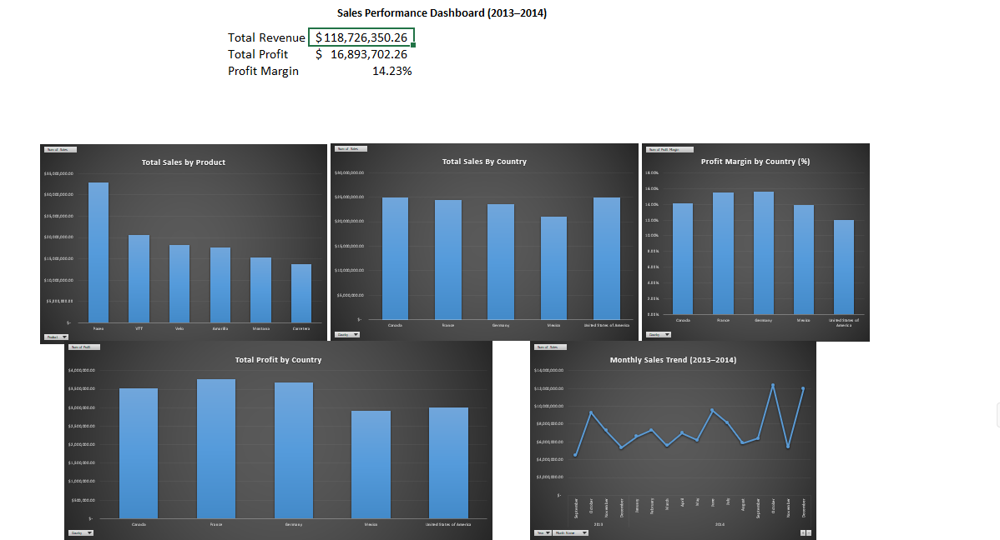

# Excel Sales Performance Analysis Dashboard

## Project Overview

This project analyses sales data from 2013 to 2014 using Microsoft Excel. The aim is to identify sales trends, compare product and country performance, evaluate profitability and provide insights to support business decision-making.

The analysis uses Microsoft's Financial Sample dataset and includes data analysis, PivotTables, PivotCharts, KPI calculations and an interactive Excel dashboard.

## Tools and Skills Used

- Microsoft Excel
- Excel formulas (SUM, AVERAGE, MIN, MAX)
- PivotTables and PivotCharts
- Data analysis and visualisation
- KPI calculations and profit margin analysis
- Business insights and recommendations

## Dashboard Preview

## Key Performance Indicators

| Metric | Value |
|---|---|
| Total Sales Revenue | $118,726,350.26 |
| Total Profit | $16,893,702.26 |
| Overall Profit Margin | 14.23% |

## Key Findings

**1. Product Performance**

Paseo generated the highest total sales revenue, approximately $33.01 million.

**2. Country Sales Performance**

The United States generated the highest revenue at approximately $25.03 million.

**3. Country Profit Performance**

France generated the highest total profit at approximately $3.78 million.

**4. Profit Margin Analysis**

Germany achieved the highest profit margin at 15.66%, while the United States had the lowest at 11.97%.

This demonstrates that higher sales revenue does not necessarily result in a higher profit margin.

**5. Monthly Sales Trends**

Monthly sales fluctuated throughout the period, with noticeable peaks towards the end of 2014.

## Business Recommendations

- Investigate the factors contributing to the United States' relatively low profit margin despite its strong sales revenue.
- Examine Germany's profitability to identify practices that may be applicable to other markets.
- Analyse Paseo's sales performance to understand its strong revenue contribution and identify opportunities for other products.

## Project Files

- **Financial Sample.xlsx** — Excel workbook containing the dataset, calculations, PivotTables, dashboard and findings.
- **sales-dashboard.png** — Screenshot of the completed Excel dashboard.

## Conclusion

This project demonstrates my ability to use Excel to analyse business data, calculate financial KPIs, build dashboards and communicate findings through data visualisation.

The analysis highlights differences between revenue and profitability and identifies areas for further business investigation.
